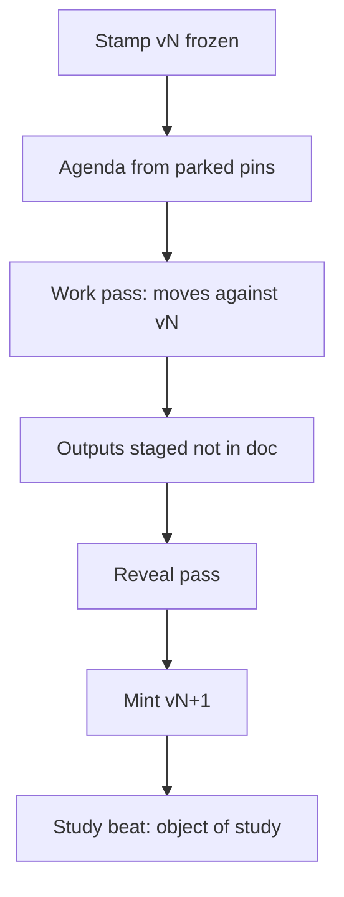
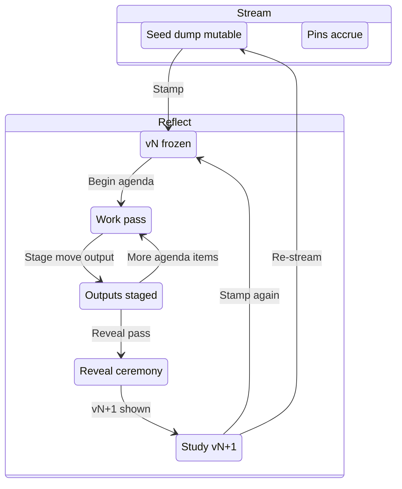

# Batch Reflection Mode — Research

**Date:** 2026-06-04
**Status:** Research complete. Informs `docs/stream-reflect-lifecycle.md` and future implementation.
**Builds on:** `docs/stream-reflect-lifecycle.md`, `docs/recursive-resolve-contract.md`, `docs/research-productivity-science.md`, `docs/plan-model-priming.md`
**Origin (Miguel's words):** *"Having done all the moves in one pass and then taking a step back to reflect on the changes the new result makes — the new version an object of study — rather than me trying to feel myself out per move to understand how this fits in the bigger picture."*

---

## 1. Clarified problem and solution

### 1.1 What is going wrong today

Mindstream's move loop treats each reflective stance as an operator that **immediately splices** its output into the live document via `resolveStepIntoPad` / `resolveStepIntoDocument` (`src/domain/thinkPadModel.js`).

That design interleaves two cognitively distinct activities:

1. **Local operator work** — What does this span need? (doubt, clarify, resolve, …)
2. **Global integration work** — How does the document read now? Am I closer to the goal I declared when I started reflecting?

After every resolve, the **reference frame drifts**. The mental map formed at stamp time is invalidated before the agenda finishes. Orientation cost compounds: annotations shift, spans move, replacements change what "the document" means mid-pass. The user must hold the north star (goal state) in working memory while the terrain reshapes underfoot — and integration is the harder of the two tasks.

This is not a discipline failure. It is a **rhythm failure** baked into the tool: *doing moves* and *integrating their consequences* are collapsed into one loop.


### 1.2 What batch reflection is

**Batch reflection** splits cultivate into three beats with hard boundaries:


| Beat            | Substrate                    | User question                                            | System role                           |
| --------------- | ---------------------------- | -------------------------------------------------------- | ------------------------------------- |
| **Work pass**   | Frozen version N (read-only) | "What does each pinned span need?"                       | Stage move outputs; do not splice     |
| **Reveal pass** | Atomic transition            | "Apply everything I staged"                              | Run all splices against N; mint N+1   |
| **Study beat**  | Version N+1 as a whole       | "What kind of document is this now? Did the gap narrow?" | Present fresh artifact; optional diff |





**During the work pass:** the visible document stays frozen at version N. Move outputs accumulate as **staged diffs** — epistemic products, not yet document truth.

**At reveal:** all staged splices apply against the frozen snapshot in one reducer pass. The user receives **one new version** — a chunk to read, not a memory of N micro-edits.

**During study:** reflection becomes **reflection-on-action** (Schön): evaluate the whole against the goal declared at stamp, not re-orient after every span.

### 1.3 Tension resolved


| Dimension        | In-place per move (today)            | Batch per pass (target)                  |
| ---------------- | ------------------------------------ | ---------------------------------------- |
| Reference frame  | Drifts after each resolve            | Stable through work pass                 |
| Cognitive mode   | Operator + integrator interleaved    | Operator batch, then integrator          |
| Unit of study    | Changing paragraph                   | Whole document version                   |
| Goal maintenance | Hold north star while terrain shifts | North star fixed at stamp; reassess once |
| Navigation       | Harder as doc accretes mid-pass      | Landmarks: vN until reveal shows vN+1    |


### 1.4 Relationship to sibling designs

- **Stream vs reflect** (`docs/stream-reflect-lifecycle.md`) — Locks **per-pass versioning**; cultivate = work-then-reveal-study.
- **Recursive resolve** (`docs/recursive-resolve-contract.md`) — A drill folds many moves into one chunk rolled up to the parent. Batch reflection is that pattern at the **root cultivate pass**.
- **Means-ends priming** (`docs/plan-model-priming.md`) — Reassess the gap **once** after operators run against a declared goal.

---

## 2. Literature review

Each source includes a **Mindstream rule** — a concrete constraint for UI or reducers.

### 2.1 Separate production from evaluation

**Hayes, J. R., & Flower, L. S. (1981).** Cognitive Process Theory of Writing. Writing decomposes into **planning**, **translating** (drafting), and **reviewing** — phases with different attentional demands. Revision is typically a **distinct pass**, not continuous inline correction.

- **Mindstream rule:** Stream = translating; cultivate work pass = local reviewing (per span); reveal + study = global reviewing (whole draft). Do not splice during work pass.

**Elbow, P. (1973, 1981).** *Writing Without Teachers.* Separates the "creative voice" (generate without judgment) from the "critic voice" (evaluate). Running both simultaneously degrades both.

- **Mindstream rule:** In-place per-move splice is critic-on-span **and** critic-on-whole at once. Batch mode keeps critic-on-span in the lens (staging) and critic-on-whole in the study beat only.

**Sommers, N. (1980).** "Revision strategies of student writers and experienced adult writers." *College Composition and Communication*, 31(4), 378–388. Experienced writers **hold the draft stable** and revise in **multiple passes**; inexperienced writers edit locally and lose global structure.

- **Mindstream rule:** Orientation loss matches the novice pattern. Batch mode scaffolds the expert pattern: stable vN during work, holistic read at vN+1.

### 2.2 Metacognition: monitor locally, evaluate globally

**Flavell, J. H. (1979).** "Metacognition and cognitive monitoring." *American Psychologist*, 34(10), 906–911. **Monitoring** (is this going well?) differs from **evaluation** (does the outcome meet the goal?).

- **Mindstream rule:** Per-move splice forces evaluation after every monitor event → working memory overload. Study beat is the sole evaluation surface for goal-relative questions.

**Schön, D. A. (1983).** *The Reflective Practitioner.* **Reflection-in-action** adjusts while doing; **reflection-on-action** steps back after a completed episode.

- **Mindstream rule:** Reveal marks the end of the episode; study beat is reflection-on-action. In-place splice only provides reflection-in-action micro-beats.

**Argyris, C., & Schön, D. A. (1978).** *Organizational Learning.* **Single-loop** fixes errors within a frame; **double-loop** questions the frame.

- **Mindstream rule:** Study beat must allow **Reframed** as a gap status (not only closed/narrowed/open), aligning with double-loop roll-up in recursive resolve.

### 2.3 Problem-solving and externalized cognition

**Newell, A., & Simon, H. A. (1972).** *Human Problem Solving.* Means-ends analysis: apply operator → **reassess current state vs goal**. Reassessment requires a **stable current state**.

- **Mindstream rule:** One reassessment point at study beat, against goal declared at stamp.

**Miller, G. A. (1956).** Chunking — recode material into units that fit working memory.

- **Mindstream rule:** vN+1 after reveal is a **chunk**. Incremental splices produce edit memories, not a readable whole.

**Kirsh, D., & Maglio, P. (1994).** Epistemic vs pragmatic action. *Cognitive Science*, 18(4), 513–549.

- **Mindstream rule:** Staged outputs are epistemic artifacts. Frozen vN is world truth until reveal.

**Hutchins, E. (1995).** Distributed cognition. *Cognitive Science*, 19(2), 265–288.

- **Mindstream rule:** Version timeline + frozen snapshot hold orientation externally (aligns with recursive-resolve Principle #2).

### 2.4 Cognitive load, attention, and navigation

**Sweller, J. (1988).** Cognitive load theory — extraneous vs germane load.

- **Mindstream rule:** Re-orienting after each splice is extraneous load. One integration cost at reveal is germane load.

**Cowan, N. (2001).** ~4 chunks in focus of attention. *Behavioral and Brain Sciences*, 24(1), 87–114.

- **Mindstream rule:** Frozen vN drops the chunk "how prior moves changed the doc" during work pass.

**Leroy, S. (2009).** Attention residue when switching tasks. *OBHDP*, 109(2), 168–181.

- **Mindstream rule:** N in-place resolves = N context switches. Batch: N moves → 1 reveal → 1 study.

**Conklin, J., & Begeman, M. L. (1988).** gIBIS — deliberation separate from synthesis; "lost in hyperspace" without landmarks.

- **Mindstream rule:** Version IDs and timeline entries are landmarks. Never mutate vN during work pass.

### 2.5 Adversarially verified additions (deep-research harness, 2026-06-04)

The following sources were surfaced, fetched, and verified by a 3-vote adversarial panel (≥2/3 refutations kills a claim). They add evidence not in §2.1–2.4 and sharpen the counter-arguments.

**Galbraith, D. & Torrance, M. (2004).** "Revision in the Context of Different Drafting Strategies." In *Revision: Cognitive and Instructional Processes*, Kluwer, pp.63–86. (4/4 verifiers, highest confidence.)
Revision cannot be treated as a unitary operation: "the effectiveness of revision depends on the form of initial draft to which it is applied." A rough draft followed by a deferred batch-revision pass produced **no improvement in final quality** over continuous editing — and a "detailed planning" strategy (structured from the start) outperformed rough-draft + batch. The mechanism: rough drafters are no more globally attentive than continuous editors when they finally revise; they still default to local substitution.

- **Mindstream rule:** The batch model only outperforms in-place editing when the revision is structured by deliberate typed moves (clarify, doubt, resolve…). Unstructured "revise this pass" would reproduce Galbraith & Torrance's null result. The move vocabulary is what makes the work pass cognitively distinct from word-level editing. Without it, batch reveal is just deferred Sommers-mode.

**Chanquoy, L. (1997).** Cited in Becker, A.B. (2006). "A Review of Writing Model Research Based on Cognitive Processes." In *Revision: History, Theory, and Practice*, WAC Clearinghouse. (Verified via secondary citation chain.)
Students who postponed revision to a dedicated later pass produced **more revisions** than those who revised immediately — but the additional revisions were predominantly **surface corrections** (word/phrase substitutions), not structural or meaning-level changes.

- **Mindstream rule (the study beat's load-bearing role):** This is the sharpest threat to the batch model. Batching without a whole-document read after reveal recreates the Chanquoy condition: more moves, but still Sommers-mode. The study beat is not UX polish — it is the specific mechanism that prevents batch + reveal from collapsing into delayed word-substitution. The whole-document read after reveal is what produces the "global integration" Chanquoy's postponed condition lacked.

**Storm, B. & Stone, T.L. (2015).** "Saving-Enhanced Memory: The Benefits of Saving on the Learning and Remembering of New Information." *Psychological Science* 26(2):182–188.
Saving (externally offloading) previously studied items significantly improved performance on a subsequent, unrelated cognitively demanding task. The mechanism: strategic offload of "currently unneeded" content reduces interference and frees attentional resources.

- **Mindstream rule:** Stamping vN is a cognitive offload of "what was there before." The user stops holding the prior state in working memory during the work pass. This is more specific than Hutchins's distributed cognition (§2.3): the offload is causal, not just structural.

**Rossmy, B. et al. (2023).** "Point of no Undo: Irreversible Interactions as a Design Strategy." *CHI '23*, DOI 10.1145/3544548.3581433. (Verified from author PDF.)
Designed irreversibility shifts user behavior from trial-and-error exploration toward premeditated, deliberate action: participants under the irreversible condition gave a median of 2.5 interactions vs 27.5 in the reversible condition, and "each step… required brain work and imagination, as the output of the step had to be played in mind upfront."

- **Mindstream rule:** The stamp + frozen-vN should be felt as a commitment device, not just a technical boundary. Once stamped, free editing is structurally impossible — this is the deliberate design. The feeling of irreversibility (you cannot simply type into the frozen document) is what induces the premeditated, forward-imagining orientation the study requires.
- **Calibration:** The CHI 2023 study used physical/tangible irreversibility (Polaroid shredding, breaking robot legs). The mechanism generalises — designed irreversibility induces deliberate action — but the magnitude (10× reduction in actions) is specific to a high-stakes physical context; do not import that number.

**Gilbert, D.T. & Ebert, J.E. (2002).** "Decisions and Revisions: The Affective Forecasting of Changeable Outcomes." *J. Personality & Social Psychology* 82(4):503–514. (Verified verbatim from gwern.net mirror.)
Reversibility of a decision **reduces post-decision satisfaction** with the chosen outcome: participants who could later exchange their print liked it less than those whose choice was final (field study and lab study). The "psychological immune system" — rationalization that produces satisfaction — fails to engage when options remain open.

- **Mindstream rule (counter-argument, scoped):** This argues FOR stamping: keeping prior drafts perpetually mutable (the undo-anytime model) suppresses commitment to the current version. But it does NOT argue against keeping vN as a read-only archive. The Gilbert & Ebert effect is about changeable *active choices*, not inspectable *historical records*. vN should be inspectable but not editable — the user has moved on to vN+1 as the active canvas.

**Zeigarnik effect — NOT robust as a design lever.** A meta-analysis of 38 publications found interrupted tasks are recalled about equally to finished tasks (weighted ratio ≈ 0.99; average effect size dz = 0.15, small). Any design argument that leaning on "open loops" keeps content more active in memory is unsupported. The Leroy attention-residue finding (§2.4) is the robust cousin: incomplete task-switching costs do accrue, but through interference, not Zeigarnik-style enhanced recall.

### 2.6 Internal productivity science

From `docs/research-productivity-science.md`:


| Principle             | Batch reflection application                        |
| --------------------- | --------------------------------------------------- |
| Working memory        | Stage outputs externally; one holistic read         |
| Cognitive load        | Minimize extraneous re-orientation                  |
| Means-ends            | Single gap reassessment after operator batch        |
| Distributed cognition | Versions and staged moves as external memory        |
| Flow                  | Clear sub-goals in work pass; gap feedback in study |
| Self-determination    | Partial reveal preserves autonomy                   |


### 2.6 Tool analogies (non-literal)


| Pattern                      | Lesson                                         |
| ---------------------------- | ---------------------------------------------- |
| Git staging → commit         | Staged moves against known base; atomic reveal |
| Track changes / suggest mode | Work pass = proposals; reveal = accept         |
| gIBIS                        | Issues resolved before synthesis into artifact |
| Scrivener compile            | Commit = compile fragments into readable whole |


Do not copy literally — no git jargon in UI.

---

## 3. UI specification

### 3.1 Phase state machine




### 3.2 Ideas panel — four states

Today `ideasForPanel` projects `parked | active | resolved`. Batch mode adds `**staged**`; post-reveal resolved items are `**committed**` within the pass narrative.


| State         | `stepId` | Output      | In document? | Affordance                          |
| ------------- | -------- | ----------- | ------------ | ----------------------------------- |
| **parked**    | null     | —           | vN unchanged | Play → perform move                 |
| **active**    | set      | in progress | vN unchanged | Lens open                           |
| **staged**    | set      | captured    | vN unchanged | Staged checkmark; edit reopens lens |
| **committed** | set      | final       | in vN+1      | History row                         |


Header progress: `**3 of 7 staged`** — informational only.

### 3.3 Think pad by sub-phase

**Stream** — Full edit; narrow/warm/dim; keystream pins.

**Reflect — work pass** — Frozen vN (read-only): select spans, no typing. Primary CTA when ≥1 staged: **Reveal pass**.

**Reflect — reveal ceremony (~400–600ms)** — Lights-up transition; optional diff preview vN → vN+1 (off by default). Block if zero staged or overlap conflicts unresolved.

**Reflect — study beat** — Default: **vN+1 only** (fresh read). On demand: vN | vN+1 diff. Prompt card:

- "What does this document say now?"
- "Closer to [goal at stamp]?"
- Gap status: **Closed** / **Narrowed** / **Still open** / **Reframed**

Timeline: `Reflect pass · 4 moves · v3 → v4`. **Skip study** — one click, always available; study is default.

### 3.4 StepLens and Moves panel


| Component                  | Batch change                                                               |
| -------------------------- | -------------------------------------------------------------------------- |
| StepLens placeholder       | "Capture the result for this pass — the document updates when you reveal." |
| StepLens primary button    | **Stage** (not Resolve)                                                    |
| Moves panel (work pass)    | Staged outputs queue, newest first                                         |
| Moves panel (after reveal) | Committed moves for this pass                                              |


### 3.5 Sensory targets


| Moment    | Target feeling                                   |
| --------- | ------------------------------------------------ |
| Stamp     | "The system noticed; here's my agenda"           |
| Work pass | "I'm on a stable map, not in a shifting swamp"   |
| Staging   | "Proposed changes; truth hasn't moved"           |
| Reveal    | "The transformation lands as one event"          |
| Study     | "I'm reading what I made, not remembering edits" |


### 3.6 Recommended defaults


| Decision                       | Recommendation                         |
| ------------------------------ | -------------------------------------- |
| Reveal naming                  | **Reveal pass** (primary)              |
| Study skippable                | Yes, one click; study shown by default |
| Diff default                   | vN+1 only; diff on demand              |
| Partial reveal                 | Allowed — subset of staged moves       |
| Per-move preview before reveal | Nice-to-have; not v1                   |


---

## 4. Model and reducer delta

Additive on schema v9; conventions from `recursive-resolve-contract.md` §5.

### 4.1 New state (illustrative)

```js
thinkPad: {
  text, annotations,
  phase: "stream" | "reflect-work" | "reflect-study",
  frozenSnapshot: {
    versionId, text, annotations,
    goalAtStamp: string | null,
  },
  stagedMoves: [{
    stepId, ideaId, output, writeBack,
    selectionStart, selectionEnd, move,
  }],
  versions: [{
    id, parentVersionId, text, annotations,
    passMeta: { moveCount, gapStatus?, stampedAt, revealedAt },
  }],
}
```

### 4.2 Reducer mapping


| Today                                    | Batch mode                                                                              |
| ---------------------------------------- | --------------------------------------------------------------------------------------- |
| `resolveStepIntoPad` splices immediately | `stageStepOutput` — output + `stagedMoves`, idea **staged**                             |
| `setPadText`                             | No-op when `phase !== "stream"`                                                         |
| lens → resolve                           | lens → **stage** during work pass                                                       |
| —                                        | `stampDraft` — freeze snapshot, `reflect-work`                                          |
| —                                        | `revealReflectPass` — splice all staged against frozen copy, mint vN+1, `reflect-study` |
| —                                        | `completeStudyBeat` — gap status, next phase                                            |


**Reuse:** `spliceStepIntoPad` runs inside `revealReflectPass` against a working copy from `frozenSnapshot`, not the live pad during work.

### 4.3 Conflict handling at reveal

1. Sort staged moves by `selectionStart` **descending** (end → start).
2. Detect **overlapping ranges** on frozen vN before apply. If overlap → **block reveal** + resolution UI.
3. **Partial reveal:** subset of staged moves; unstaged pins carry to vN+1.

### 4.4 Persistence

Default-fill new fields in `contextPersistenceMapper.js`; no schema version bump.

---

## 5. Anti-patterns


| Anti-pattern                             | Why it fails                                                                                      | Alternative                                                              |
| ---------------------------------------- | ------------------------------------------------------------------------------------------------- | ------------------------------------------------------------------------ |
| Nagging "finish all 7 moves"             | Violates autonomy                                                                                 | `3 of 7 staged` as info only                                             |
| Hiding staged outputs                    | Breaks trust                                                                                      | Moves panel always shows queue                                           |
| Reveal with zero staged                  | Empty ceremony                                                                                    | Disable primary action                                                   |
| Forced study with no skip                | Trapped in loop                                                                                   | Default study + skip                                                     |
| In-place splice during work              | Recreates orientation bug                                                                         | Reducer guard                                                            |
| Git vocabulary                           | Wrong tone                                                                                        | "Reveal pass", "Stage"                                                   |
| Auto-reveal when last staged             | Removes ceremony                                                                                  | User triggers reveal                                                     |
| Per-move version timeline                | Same WM problem                                                                                   | One version per reveal                                                   |
| Silent overlap merge                     | Sussman clobber                                                                                   | Block + resolution UI                                                    |
| Unstructured work pass ("revise freely") | Reproduces Galbraith & Torrance null result: no quality gain over in-place                        | Move vocabulary required; typed structured moves only                    |
| Skippable study beat as opt-in           | Reproduces Chanquoy surface-correction trap: batch without whole-text read = delayed Sommers mode | Study beat default-on; single-click skip available but not default       |
| vN kept mutable / undoable after stamp   | Gilbert & Ebert: reversibility suppresses satisfaction/commitment to the next version             | vN is read-only archive; re-stream forks a new stream, never restores vN |


---

## 6. Implementation sequence (suggested)

1. Domain: `stageStepOutput`, `revealReflectPass`, freeze guard, `ideasForPanel` staged state
2. Store: block `resolveStepIntoDocument` during work pass
3. UI: StepLens + Reveal CTA + study card
4. Timeline: version list
5. Tests: overlap detection, reverse-order splice, partial reveal

---

## 7. References

- Argyris, C., & Schön, D. A. (1978). *Organizational learning.* Addison-Wesley.
- Conklin, J., & Begeman, M. L. (1988). gIBIS. *ACM TOIS*, 6(4), 303–331.
- Cowan, N. (2001). The magical number 4. *BBS*, 24(1), 87–114.
- Elbow, P. (1981). *Writing with power.* Oxford.
- Flavell, J. H. (1979). Metacognition. *American Psychologist*, 34(10), 906–911.
- Hayes, J. R., & Flower, L. S. (1980). Writing processes. In *Cognitive processes in writing.*
- Hutchins, E. (1995). How a cockpit remembers its speeds. *Cognitive Science*, 19(2), 265–288.
- Kirsh, D., & Maglio, P. (1994). Epistemic vs pragmatic action. *Cognitive Science*, 18(4), 513–549.
- Leroy, S. (2009). Attention residue. *OBHDP*, 109(2), 168–181.
- Miller, G. A. (1956). The magical number seven. *Psychological Review*, 63(2), 81–97.
- Newell, A., & Simon, H. A. (1972). *Human problem solving.* Prentice-Hall.
- Schön, D. A. (1983). *The reflective practitioner.* Basic Books.
- Sommers, N. (1980). Revision strategies. *CCC*, 31(4), 378–388.
- Storm, B. & Stone, T.L. (2015). Saving-enhanced memory. *Psychological Science*, 26(2), 182–188.
- Sweller, J. (1988). Cognitive load. *Cognitive Science*, 12(2), 257–285.
- Chanquoy, L. (1997). In Becker, A.B. (2006). A review of writing model research. *WAC Clearinghouse.*
- Galbraith, D. & Torrance, M. (2004). Revision in the context of different drafting strategies. In *Revision: Cognitive and Instructional Processes*, Kluwer, pp.63–86.
- Gilbert, D.T. & Ebert, J.E. (2002). Decisions and revisions. *JPSP*, 82(4), 503–514.
- Rossmy, B. et al. (2023). Point of no undo. *CHI '23*, DOI 10.1145/3544548.3581433.
- Norton, M., Mochon, D. & Ariely, D. (2012). The IKEA effect. *J. Consumer Psychology*, 22(3), 453–460.
- Shipman, F. & Marshall, C. (1999). Formality considered harmful. *CSCW*, 8(4).

**Internal:** `docs/stream-reflect-lifecycle.md`, `docs/recursive-resolve-contract.md`, `docs/research-productivity-science.md`, `docs/plan-model-priming.md`

---

## 8. Through-line

Reflection should feel like **finishing a pass of thinking and then reading what you thought** — not like **editing a document that keeps rearranging itself under you**. Batch mode makes the document a **stable map during work** and a **new object of study after reveal**.